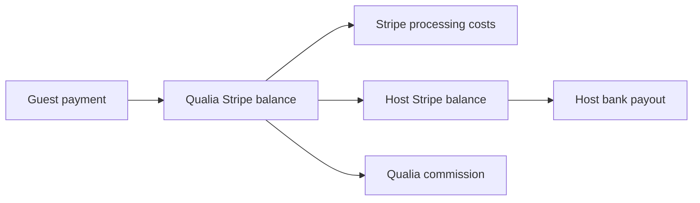

# Qualia — Phase 5 Stripe implementation plan

Implementation research dated 2026-10-11. No financial resources were created during that research. The subsequent October 12 setup connected an existing sandbox and created webhook destinations; see [current Stripe operations](stripe-operations.md#current-sandbox-configuration--october-12-2026) for the unresolved Connect source/duplicate check and missing runtime key. No payments, transfers or payouts have been performed.

**Recommendation:** Stripe-hosted Checkout, Accounts v2 connected accounts, and **separate charges and transfers if hosts receive funds only after the experience is completed**. Keep live charging disabled until the owner approves payout timing, fees and commercial terms. If immediate transfer at payment is acceptable, destination charges are simpler; that is a different implementation choice, not a payout-delay setting.

## Readiness and exact versions

At the original research checkpoint only a live account was visible. An existing sandbox is now connected and verified as `livemode=false`; this does not establish Connect activation, runtime credentials or payment readiness. The original account-specific implementation planner was used only for research; guide iguide_61VYr6JxdYQZjsKKP41DqyZniopvO remains draft. Commercial agreements and launch gates remain separate from connector visibility.

Use a separate Stripe sandbox for development, with separate CI isolation when available. Pin **stripe-node 23.0.0 / Stripe API 2026-09-30.endive**: the live API versioning documentation and the downloaded npm package's `apiVersion.js` agree. The installed skill's older Dahlia/22.6.0 recommendation is stale. Instantiate a server-only SDK client; pin compatible webhook snapshot versions. Recheck versions at implementation time. [1]

## Connected account configuration and onboarding

- Accounts API: `POST /v2/core/accounts`; no legacy account `type`.
- Dashboard: Express, the lightweight host view (`dashboard: 'express'`).
- Fee collection: Qualia manages pricing (`defaults.responsibilities.fees_collector: 'application'`).
- Negative balance liability: Qualia (`defaults.responsibilities.losses_collector: 'application'`).
- Recipient configuration: request `configuration.recipient.capabilities.stripe_balance.stripe_transfers.requested: true`. Do not add merchant/card-payment capabilities for this funds flow.
- United States/USD launch; obtain the host's actual entity details through onboarding, rather than assuming every host is an individual.

Create one connected account per host per Stripe environment with a durable operation ID. Persist the returned ID privately. Use Stripe-hosted onboarding through `POST /v2/core/account_links` and authenticated return/refresh routes; this minimizes UI and sensitive-data handling. Returning from onboarding is not proof of completion. Re-fetch the account with the needed recipient configuration included and require active `configuration.recipient.capabilities.stripe_balance.stripe_transfers.status` and `configuration.recipient.capabilities.stripe_balance.payouts.status` before enabling a paid listing/checkout and again before transfer. [2–3]

Provide Express dashboard login links generated server-side after host ownership checks. Recommend embedded `notification_banner` and `account_management` for ongoing requirements; `account_onboarding` is the later in-app alternative to hosted onboarding. `payouts` can supplement the earnings page. Payment/dispute embedded components have reduced visibility for indirect charges: Qualia must own refund/dispute support and its own booking ledger. [2–3]

## Payment and transfer flow

1. Guest requests an available slot; no payment is taken. Host accepts through an authenticated, atomic database transition that reserves the slot exclusively.
2. Guest opens Checkout while that acceptance is valid. Server rechecks guest ownership, approval/listing status, capacity, host readiness and commercial configuration. Snapshot price, currency, duration, cancellation terms, fee schedule and promotion entitlement; never accept these amounts from the browser.
3. Create `POST /v1/checkout/sessions`, `mode: 'payment'`, hosted UI, USD server-derived line item, `client_reference_id` and metadata booking/attempt IDs, plus matching PaymentIntent metadata. Set `payment_intent_data.transfer_group` to the booking's stable group and `integration_identifier` to a stable deployment label ending in eight random letters. **For separate charges/transfers, omit both `transfer_data` and `application_fee_amount`.** Return the generated Session URL; this is a booking-specific payment link, not a reusable generic Payment Link. [4–5]
4. Checkout expiration must align with the database hold. Stripe allows `expires_at` 30 minutes–24 hours after creation. Require enough remaining acceptance time or extend it atomically according to an approved policy. A worker expires abandoned Sessions before releasing inventory; payment-processing Sessions remain reserved until terminal reconciliation.
5. Confirm booking only from verified payment state, never from the success-page redirect. `checkout.session.completed` can still be unpaid; wait for confirmed payment. The success page reads the booking and can show “payment processing.” [6]
6. Following an owner-approved completion rule and delay, enqueue a transfer. Lock the settlement row and confirm payment succeeded, experience completed, no cancellation/refund/dispute hold, and host capabilities active. Create `POST /v1/transfers` with destination, exact net amount, currency, booking group and the successful Charge ID as `source_transaction`; never transfer an async payment merely because a Session completed. Record one logical transfer operation per settlement version. Stripe does not automatically retry a failed transfer. [4]
7. Transfer means funds reached the host's Stripe balance; payout means Stripe sends that balance to the host's bank. Use the agreed connected-account bank-payout schedule after transfer. Show these separately; do not promise a bank-arrival date from the transfer timestamp. Platform liquidity/payout policy must retain sufficient funds for unpaid host obligations and refunds. Do not describe the platform balance as escrow or promise segregated funds. [4, 9]

If the owner chooses immediate transfer instead: use destination charges with `payment_intent_data.transfer_data.destination` and explicit `application_fee_amount`; refund/reversal logic must change to that pattern. Do not mix both patterns for one booking. [10]

## Fee and incentive ledger

Commercial policies remain **unset in the database**, not zero defaults. The owner has approved 17.5% standard commission and delegated the selected 10% lifetime founding rate after the initial free period. Processor-cost responsibility, referral-credit size/cap, incentive enrollment/cutoff terms, refund counting and payout delay still need agreement. Saving an approved policy creates an immutable version; every checkout stores the applicable version. Existing founders retain their agreed rate if a later policy changes.

For the proposed separate flow, calculate initial host entitlement as guest payment less approved commission/cost deductions; adjust that entitlement for refunds under the agreed fee-refund policy. The next transfer is remaining entitlement less prior transfers plus applicable reversals, bounded at zero. Use integer cents and ledger entries, not mutable counters. Do not use `application_fee_amount` or the Platform Pricing Tool. The `applicationFeeIncludes` setting is not applicable to this flow; the equivalent processing-cost policy must explicitly be `platform_absorbs` or an approved, disclosed host deduction. Taxes/tips, if added, need separate line-item ownership rules.

During the founding incentive, commission is zero while both the booking-count and time eligibility tests pass. **Zero commission does not make Stripe free.** If Qualia absorbs processing, a $100 domestic-card payment at the current illustrative 2.9% + $0.30 costs $3.20 before Connect costs; 400 such free-commission bookings cost $1,280 in processing alone. Published US Connect platform-pricing charges include $2 per active account/month and 0.25% + $0.25 per payout; verify the account's actual pricing and applicable line items before budgeting. These are model assumptions, never hardcoded processor rates. Passing processing costs to hosts requires approved, clear offer wording. [11–12]

The transfer to the host is calculated from the approved fee policy; during the incentive Qualia's commission branch is zero. Bank payout timing is distinct from experience completion and transfer release.

**Prevent two concurrent “10th free booking” grants:** maintain `host_incentive_terms` plus `incentive_reservations` with states reserved/consumed/released, unique booking grant, and a lock on the host's entitlement row. In the checkout transaction, grant a reservation only if consumed plus outstanding reservations is below ten and the approved time rule permits it. Payment success consumes the reservation exactly once. Terminal failed/expired checkout releases it only after Stripe confirms no payment is still processing; client cancellation or local TTL alone is insufficient.

If all remaining free slots are reserved but fewer than ten payments have succeeded, delay opening additional regular-fee Checkouts until those reservations settle or expire. This prevents charging commission on the actual tenth successful payment after an earlier reservation fails. Set short, bounded checkout holds. Freeze the quoted entitlement; never retroactively deduct a fee after payment. Define the six-month boundary and any processing-session grace explicitly before coding; calendar months, time zone, start event and whether refunds restore a credit are product decisions. Referral grants need their own unique qualifying-referral ledger and approved cap, not unrestricted decrementing of the founding counter.

## Webhooks and idempotency

Use verified webhooks and canonical Stripe object retrieval to reconcile payment, account and payout states, with durable deduplication and retryable processing. [6–8]

| Sandbox destination | Events to subscribe | Handler responsibilities |
|---|---|---|
| Platform v1 payment snapshots | `checkout.session.completed`, `checkout.session.async_payment_succeeded`, `checkout.session.async_payment_failed`, `checkout.session.expired`; `payment_intent.succeeded`, `payment_intent.payment_failed` | Correlate attempt/booking; re-fetch Session/PaymentIntent; verify environment, USD amount, guest and booking; transition once. A failed retry must not downgrade a later successful attempt. |
| Platform v1 adjustments | `refund.created`, `refund.updated`, `refund.failed`, `charge.refunded`; `charge.dispute.created`, `charge.dispute.updated`, `charge.dispute.closed`; `transfer.created`, `transfer.reversed` | Update refund/dispute/reversal ledgers; freeze release when required; reconcile Dashboard-originated actions too. |
| Connected-account v1 snapshots | `payout.created`, `payout.updated`, `payout.paid`, `payout.failed`, `payout.canceled`, `payout.reconciliation_completed` | Verify connected-account context; reconcile each payout and its constituent balance transactions. `payout.paid` can be followed by failure; do not regard it as irreversible. |
| Accounts v2 thin notifications | `v2.core.account[configuration.recipient].capability_status_updated`, `v2.core.account[configuration.recipient].updated`, `v2.core.account[requirements].updated`, `v2.core.account.closed` | Verify thin signature; fetch related/current account; update capability and requirement cache; suspend new checkout/transfer when restricted. |

Use distinct routes/secrets for these delivery formats. With Node, verify v1 raw bodies using `client.webhooks.constructEvent`; parse v2 thin notifications using `client.parseEventNotification` and retrieve related objects. Reject the wrong Stripe environment or unrelated account context. Do not route v2 payloads through a v1 snapshot parser. [7–8]

Insert verified events into an inbox with unique `(environment, account_context, event_id)` plus a work item in one DB transaction, then acknowledge. Workers lock payment/booking/entitlement rows; persist financial state and email outbox entries atomically. An event inserted but not processed must stay retryable. Event delivery is duplicated and unordered: use resource IDs and state reconciliation, not event timestamps as ordering guarantees. Use logical-operation uniqueness too, since different Stripe event IDs can describe the same transition.

Every mutating Stripe call gets a stable idempotency key derived from a persisted operation UUID and immutable request parameters. The DB operation record outlives Stripe's key-retention window. On network uncertainty reconcile the prior operation before issuing a new call; never generate a fresh key on every retry. Enforce one payable Session/attempt per booking and one successful booking payment; if a late, superseded Session pays, quarantine and refund according to policy rather than double-booking or silently keeping both payments.

## Refunds, disputes and payout state

Keep orthogonal booking, payment, refund, transfer and bank-payout states. For example: booking confirmed/completed/canceled; payment processing/paid; refund requested/pending/succeeded/failed; transfer queued/transferred/partially-reversed/reversed; payout pending/in-transit/paid/failed/canceled. A refund must not overwrite the history that the original payment succeeded.

For separate charges/transfers, refunding the platform charge **does not reverse transfers**. Before release, cancel or reduce the pending transfer. After release, create an explicit partial/full reversal and a refund as a persisted, retryable saga: neither API call and the database are one transaction. Record independent refund and recovery outcomes, alert on failed recovery, and avoid refunding twice on replay. Do not delay an owed customer refund merely because host recovery failed. [4]

Disputes freeze pending release and trigger the approved recovery procedure for already-transferred amounts. The dispute debits Qualia; recovery is not automatic or guaranteed. Avoid both refunding and treating a dispute debit as a second customer reimbursement. Reconcile dispute resolution before releasing/reinstating funds. Payouts can aggregate many bookings; reconcile via balance transactions, not by marking every booking belonging to the host as paid out. [4, 7, 9]

### Negative balance liability

Qualia is liable for negative balances with this configuration. Transfer reversals support recovery from hosts; insufficient funds, bank withdrawals and Stripe account restrictions can prevent recovery or leave negative balances. Express hosts have limited dispute/refund controls for indirect charges, so Qualia needs operational ownership and an alerts queue. [2, 4]

### Risk management

Use Stripe Radar and platform controls independently of liability: authenticated booking, authoritative pricing, listing review, velocity limits, manual dispute/refund review and a release hold on unresolved problems. Stripe onboarding is payment verification; it does not establish experience safety or insurance coverage.

## Runtime configuration and launch gates

| Name | Requirement |
|---|---|
| `STRIPE_RESTRICTED_KEY` | Server-only sandbox key using the exact [implemented permission matrix](stripe-operations.md#before-sandbox-use). Hosted Account Links are used; Events retrieval and account-session permissions are not required. Verify scopes with real sandbox requests. Never commit or expose it. |
| `STRIPE_WEBHOOK_SECRET_PLATFORM` | Sandbox v1 platform signing secret. |
| `STRIPE_WEBHOOK_SECRET_CONNECT` | Sandbox connected-account snapshot signing secret. |
| `STRIPE_WEBHOOK_SECRET_ACCOUNTS_V2` | Sandbox thin-notification signing secret. |
| `NEXT_PUBLIC_STRIPE_PUBLISHABLE_KEY` | Sandbox public key only when embedded Connect components are implemented; hosted Checkout redirect alone does not require it. |
| `STRIPE_ENVIRONMENT` | `sandbox` initially; assert observed resource/event mode matches the configured environment. |
| `STRIPE_LIVE_PAYMENTS_ENABLED` | `false` until explicit owner approval and launch gates pass; missing value fails closed. |
| `NEXT_PUBLIC_SITE_URL` | Trusted deployment origin for server-generated return/refresh/success/cancel URLs. |
| `CRON_SECRET` | Authenticates `GET /api/jobs/email` only; no schedule is enabled. Financial reconciliation and release are operator-initiated, not scheduled workers. |

Existing server-side Supabase service-role access supports the financial ledger and workers; no direct client writes to financial tables. Store Stripe secrets as sensitive Vercel environment variables scoped by environment. Keep fee basis points and host contract versions in a validated, versioned server-side commercial-policy record, not public environment variables. Pin API version in code. Do not set `automatic_tax` until the owner confirms the applicable tax setup/active registrations. [13]

Implementation order: ledger/migrations and fail-closed configuration; connected-account onboarding; acceptance-to-Checkout; webhook inbox/workers; promotion locking; completion release/refund saga; earnings/payout status; sandbox tests; owner-reviewed live rollout. No subscription/SaaS billing is needed for free host listings.

Meaningful sandbox gates: failed payment and 3DS; delayed-method success/failure; duplicate/reordered events; checkout expiry versus late payment; simultaneous 9th/10th/11th incentive attempts; six-month boundary; duplicate checkout clicks; restricted host; refund before/after release and partial refund; transfer failure/retry; payout failure after paid event; reconciliation after a lost webhook. Test processor API timeouts between Stripe success and DB commit. A connected live account alone does not satisfy any of these gates.

## Owner decisions before charging

1. Hold host funds until completion or transfer immediately; completion authority, release delay and booking horizon.
2. Record the approved 17.5% standard and selected 10% lifetime founding rates; decide who bears processing/Connect costs, referral grant and cap.
3. Incentive start/time-zone/cutoff/refund rules, payment deadline and cancellation/no-show/refund policy.
4. Confirm Qualia's customer-facing payment/support responsibility and acceptance of the proposed negative-balance responsibility.
5. Finish the connected sandbox's runtime restricted key, resolve webhook source/duplicate configuration and deploy the stored secrets; later separately approve live enablement.

## Primary references checked

1. [API versioning](https://docs.stripe.com/api/versioning); [official stripe-node package](https://www.npmjs.com/package/stripe). npm metadata and v23.0.0 package `apiVersion.js` checked locally.
2. [Create marketplace connected accounts](https://docs.stripe.com/connect/marketplace/tasks/create); [Accounts v2 configuration](https://docs.stripe.com/connect/accounts-v2/connected-account-configuration).
3. [Marketplace onboarding](https://docs.stripe.com/connect/marketplace/tasks/onboard).
4. [Separate charges and transfers — hosted Checkout](https://docs.stripe.com/connect/separate-charges-and-transfers?platform=web&integration=checkout&ui=stripe-hosted).
5. [Create Checkout Session](https://docs.stripe.com/api/checkout/sessions/create).
6. [Checkout fulfillment](https://docs.stripe.com/checkout/fulfillment?payment-ui=stripe-hosted).
7. [Webhook handling](https://docs.stripe.com/webhooks?lang=node).
8. [Accounts v2 event catalog](https://docs.stripe.com/api/v2/core/events/event-types); [v1 event catalog](https://docs.stripe.com/api/events/types).
9. [Manage payout schedule](https://docs.stripe.com/connect/manage-payout-schedule).
10. [Destination charges — hosted Checkout](https://docs.stripe.com/connect/destination-charges?platform=web&ui=stripe-hosted).
11. [US payment pricing](https://stripe.com/pricing).
12. [Connect pricing](https://stripe.com/connect/pricing).
13. [Stripe keys](https://docs.stripe.com/keys); [sandbox environments](https://docs.stripe.com/sandboxes).
